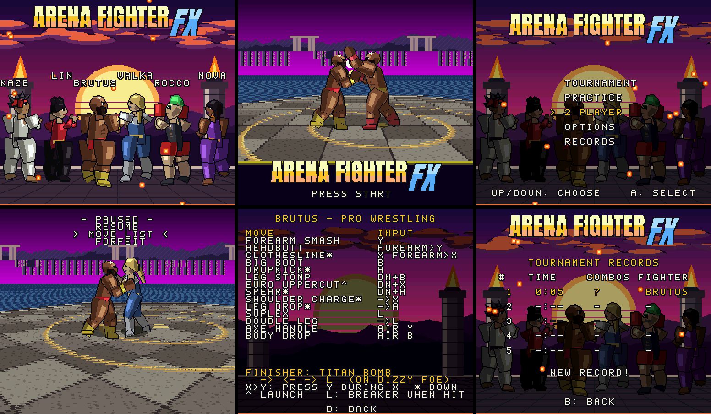

# SAVAGE DOMINION

A side-view SNES Super FX fighting game, in early development. It starts from the code of
[Arena Fighter FX](https://github.com/xenocide21/Arena-Fighter-FX) (branch `valka-anatomy`, commit 694db4e),
used under the MIT License. Concept and direction by Xenocide21; developed with Claude, an AI model made by Anthropic.

The text below this line describes the Arena Fighter FX base and will be replaced as the game changes.

---

# ARENA FIGHTER FX

*A 3D arena fighter for the Super Nintendo, drawn by the Super FX chip.*



- Free and open source under the **MIT License** (see [LICENSE](LICENSE)).
- **Made with AI, openly:** game concept and direction by Xenocide21; code, art, sound and manual written with
  [Claude](https://claude.ai) (an AI model made by Anthropic).
- The ROM (`arena_fighter_fx.sfc`) and the printable package (manual PDF, front cover, back insert, disc label)
  are on the **Releases** page. Build it yourself with `./build.sh` (needs cc65 and Python 3 + Pillow).
- Game manual and print art: [`manual/`](manual/) (`python3 manual/make_art.py && python3 manual/make_manual.py`;
  needs reportlab). Known issues and plans: [TODO.md](TODO.md).
- Not affiliated with or endorsed by Nintendo.

---

# ARENA FIGHTER FX (SNES homebrew, Super FX)

A 3D arena fighter for the Super Nintendo in the spirit of Soul Calibur and Tekken.
It uses a Mode 7 perspective arena, a rotating camera and ball-jointed fighters drawn by the
**Super FX (GSU-2)** chip.

## Playing

`arena.sfc` is a 1 MB Super FX (GSU-2) cartridge: LoROM/FastROM, 64 KB Game Pak RAM. Use an emulator with Super FX support (snes9x, bsnes/higan/ares, Mesen-S, RetroArch cores based on those). It boots into an attract-mode demo.

- **P1 Start**: Arcade. Pick a fighter, then beat the other five in order to become CHAMPION.
- **P2 Start**: Versus (2 players). Also works mid-arcade, as "a new challenger".

### Character select

- **Left/Right**: change fighter. The fighters are shown live in the arena.
- **Any button**: lock in.
- **Same fighter for both players**: player 2 gets an alternate costume.

### Controls (in a fight)

| Input | Action |
|---|---|
| Left / Right | Walk (holding away from the opponent also guards) |
| Up | Jump (Up+toward / Up+away jumps in / out) |
| Down | Crouch (high attacks pass over you) |
| Double-tap toward / away | Dash in / backdash |
| R | Guard; Down + R (or Down + away) is crouch guard |
| R + Up / R + Down | Sidestep into / out of the screen (hold to keep circling) |
| Y / X / B / A | Punch / power punch / kick / power kick (every fighter's own versions) |
| Toward, Away or Down + a button | Each fighter's special moves |
| A button in the air | Air attack (punch with Y/X, kick with B/A) |
| L | Throw (unblockable, close range, misses crouchers and jumpers) |
| Any button while down | Get up early |

**Strings:** many moves chain into a follow-up if you press the next button while the
first hit is still out, e.g. ROCCO's jab, cross, hook, uppercut is Y, X, Y, X.

**Combos (Killer Instinct style):** once a hit connects, *any* ground move can cancel
into any other (each move up to 3 times per combo), so strings and cancels link into long
combos. Inputs are buffered for 12 ticks, so press the next button early.
- Single hits are weak (half damage); every extra hit in a combo adds 1/16 more damage,
  up to 2.5x. Big combos are where the damage is.
- Ranks when a combo ends: 3 TRIPLE, 4 SUPER, 5 HYPER, 6 BRUTAL, 7 MASTER, 8 AWESOME,
  9 BLASTER, 10 MONSTER, 11 KING, 12-15 KILLER, 16-20 INSANE, 21+ ULTRA.
- Knockdowns only come from enders at the end of a 5+ hit combo, launchers in a 4+ hit
  combo, sweeps, throws, KOs, or hitting someone in the air.
- **Overkill:** a combo that empties the health bar keeps going until it ends; then they drop.
  The stick direction is remembered with each buffered press.
- **COMBO BREAKER:** press L while you're being comboed (3rd hit on), once per round.

**FINISHERS:** when a K.O. would decide the match, the loser is instead left **dizzy**
at a sliver of health for 5 seconds, stars circling their head ("FINISH THEM!"; the clock
stops). Get close and enter your fighter's code, one press per step, quickly:

| Fighter | Finisher | Code |
|---|---|---|
| KAZE | Thousand Fists | <- -> -> X |
| LIN | Dragon Tempest | Down Down -> A |
| BRUTUS | Titan Bomb | -> <- -> L |
| VALKA | Valhalla Falls | Down <- Down X |
| ROCCO | Knockout King | -> -> -> Y |
| NOVA | Carnaval Storm | <- Down -> A |

The game then takes over: the screen darkens, the camera swings around the fighters, and
a 12-18 hit flurry ends in a launch, an air strike and a final blow that sends them flying
(sometimes right out of the ring): "FINISHED!". Any ordinary hit just knocks them out,
and if nobody acts in 5 seconds they drop on their own. The CPU goes for its finisher too
(more often at higher levels). (Arrows are relative to your opponent: -> = toward.)

The arcade CPU starts slow and patient and gets faster, more aggressive and better at
combos (and breakers) with each opponent you beat.

Full per-fighter lists are in [MOVELIST.md](MOVELIST.md) (generated from
`tools/fighters.py`, ready for the in-game moves legend).

### Rules and mechanics

- Highs whiff on crouchers; lows beat standing guard; mids beat crouch guard.
- A well-timed sidestep makes a committed attack miss.
- Counter hits (hitting a fighter mid-attack) do +25% damage.
- Juggles do 75% damage and are capped at 4 hits.
- Jumping clears low attacks; getting hit in the air knocks you down. Jump attacks are mids.
- Knockdowns and launches push fighters back, and near the edge they go over: **ring out**.
- Rounds last 60 seconds and you need 2 rounds to win. On time-out, the fighter with more health wins.


## Menus and modes

- **Splash:** the six fighters stand as silhouettes against a sunset arena, then light up
  one by one with their names; the ARENA FIGHTER FX logo fades in. Clouds drift, torches
  burn, embers float up. START (or waiting) goes to the home screen.
- **Home screen:** two CPU fighters battle it out, with the logo in a band at the bottom.
  START opens the main menu. Left idle, it cycles back to the splash.
- **Main menu:**
  - **TOURNAMENT:** pick a fighter and beat the other five in a row. Your fighting time and
    the number of combos (3+ hits) you land are recorded.
  - **PRACTICE:** pick your fighter, then a sparring dummy. The dummy never fights back,
    heals between combos and can't be knocked out of the ring (the edge is a wall). There's
    no clock. SELECT leaves the dummy dizzy so you can practise your finisher.
  - **2 PLAYER:** both players pick a fighter.
  - **OPTIONS:** music and effects volume (0-10).
  - **RECORDS:** the five fastest tournament clears (time, combos, fighter).
- **Pause (START in a fight):** RESUME, MOVE LIST (that fighter's full move list, strings
  and finisher code), and FORFEIT (or EXIT PRACTICE). In 2 player matches the move list is
  locked out: fight from memory!
- **Saving:** the only thing saved is the records table, in the cartridge's battery-backed
  Super FX RAM ($70:F000, with a checksum). Options are not saved.

## The roster

| Fighter | Sex | Style | Look | Signature moves |
|---|---|---|---|---|
| KAZE | M | Karate | White gi, red headband, spiky hair | Jab-reverse punch-roundhouse string, side kick, axe kick, flying side kick |
| LIN | F | Kung fu | Red tunic, twin buns, gold sash | Three-hit chain palms, crescent and tornado kicks |
| BRUTUS | M | Wrestling | Beard, red trunks, yellow boots and wristbands | Clothesline, spear, dropkick, suplex and double-leg takedown |
| VALKA | F | Viking | Blonde braid, blue tunic, silver shoulder guards | Hammer fist strings, spinning backfist, flying knee, heel drop |
| ROCCO | M | Boxing | Green mohawk, red gloves, shades | Jab-cross-hook-uppercut, calf kick, superman punch |
| NOVA | F | Capoeira | Purple outfit, ponytail, orange scarf | Martelo, armada, meia lua, rasteira, bencao |

Each fighter has their own proportions, stance, speed, power and weight.

## Super FX rendering: sculpted polygon fighters

Each fighter is built like a sprite artist builds a figure: out of hand-authored shapes riding on the animated skeleton.

**Parts.** The parts are torso, pelvis, head, upper arms, forearms with fists, thighs and shins with feet, plus hair and costume chains (braid, ponytail, headband tails, belt and sash ends, scarf). Each part is a list of convex polygons stored in bone space as (s, o):

    point = A + s * (B - A) + o * scale * perp(B - A) / |B - A|

- s is a fraction of the projected bone (1/32 steps, -4..+4).
- o is a sideways offset in design units, scaled by depth.
- Facing the other way just mirrors o.

**Anatomy and costume are sculpted** from width profiles along each bone and from side-view drawings:
- body: deltoids, biceps and triceps, forearm muscle, quads, calves, chest and back curves, glutes
- face: jaw, nose, brow, eyes and lips
- clothing: gi lapels, belts and sashes, trunks, a chest guard, shoulder guards, sleeves, wristbands, boots, gloves and shades
- hair: spikes, buns, a braid, a mohawk, a ponytail, and a beard on a bald head

**Shading is painted in as shapes:**
- a dark band on the back of each limb and a lit strip on the front
- chest light, forehead light, pec and ab lines
- far-side limbs are one shade darker, for depth
- an ink outline around every main shape: the filler draws the polygon's border pixels in ink, so the outline is nearly free

**Palette.** One 15-colour palette per fighter: skin, hair and two outfit materials at three shades each, plus white, trail and ink. Mirror matches use an alternate costume.

**Anatomy first, costume on top (all six fighters).** `tools/anatomy.py` builds every fighter in two layers:
1. **Anatomy:** a per-fighter `PHYSIQUE` (side-view width profiles for the pelvis, ribcage, thighs, calves,
   ankles, upper arms and forearms, plus joint radii, fist and foot sizes). Male and female base bodies are
   scaled region by region (chest, waist, belly, hips, glutes, bust, arms, legs, neck): BRUTUS gets a barrel
   chest, belly and thick neck, LIN a small wiry frame, NOVA long legs, ROCCO a boxer's shoulders.
2. **Costume:** clothes and gear are slices of those profiles, a little inflated (boots = calf and ankle
   profiles from below the knee; a gi sleeve is the arm profile inflated; shorts and trunks are the pelvis plus
   the top of the thigh; the shoulder guard follows the deltoid dome), so clothing always sits on the body.
   Each fighter's `costume` dict in `STYLES` (model.py) lists its layers.

Joints are built so they stay connected as limbs rotate:
- every limb starts with a dome around its socket (hip, shoulder, knee, elbow)
- its ink outline starts just below the joint, and the dome fills over that cut, so the thigh flows out of
  the pelvis and the shin out of the knee with no outline ring
- concave shapes (lumbar curve, calf to Achilles) are two convex pieces plus a small bridge fill
- the near shin draws over the thigh end at the knee

Spending: the Super FX pays per vertex (transform + edge setup is ~55% of its time), not per pixel. So the
exporter re-hulls after quantising and drops near-collinear vertices (`simplify`), and detail shading is left
out of the far-side limb variants. Vertex counts match the old models; measured Super FX time is within a
few percent per matchup. `preview/roster_anatomy_before_after.png` compares the roster.
`python3 tools/model_lab.py VALKA --yaw 0,40,70` renders a pose sheet (also from orbiting camera angles) with
the exact Super FX maths.

**The tools.** The models live in `tools/model.py` (with `STYLES` per character). Running it renders `preview/models.png` with exactly the Super FX maths, for fast iteration.

**Each frame:**
1. **The 65816** projects the 20 skeleton joints and emits one display-list entry per part: bone ends on screen, depth scale, facing, a pointer to the part's shapes (near or far variant), and a depth key for painter's order. It also picks a sprite box per fighter (2×3 blocks of 32×32 for upright poses, 3×2 for knockdowns and sweeps).
2. **The Super FX** (21 MHz, running entirely from Game Pak RAM) clears the fighter tiles and, for every polygon:
   - transforms the points (four hardware multiplies each)
   - fills them with a convex polygon filler: edge chains with 8.8 slopes from a reciprocal table (the GSU has no divide)
   - in the common 2×3 box, plots each scanline inline, including the ink border, straight into sprite-format tiles (GSU "OBJ mode")

   Each character's shapes (~2 KB) are uploaded into Game Pak RAM when the matchup changes.
3. **The NMI** uploads the finished 6 KB of tiles in one vblank, double-buffered between the two sprite name tables, together with OAM and the camera.

The 65816 builds frame N+1 while the GSU draws frame N.

The Super FX effects:
- **Motion trails:** the striking hand or foot leaves fading ghost discs during an attack.
- **Impact bursts:** six hot sparks fly out from the point of contact.
- **Hit flash:** a fighter flashes white-hot when a clean hit lands.
- **KO slow motion:** about a second of half-speed after the knockout blow.

Performance: 30 fps in snes9x's legacy Super FX timing, with ~60 polygons per fighter. Current snes9x
(cycle-accurate Super FX, closer to real hardware) measures about 12 fps in fights; see TODO.md. The tile upload is a little more than one vblank holds, so the screen is blanked for a few lines at the very top (inside TV overscan).

## Building

Requirements: cc65 (`ca65`/`ld65`) and python3 with Pillow.

```
./build.sh          # -> arena.sfc
```

### Tools

- `tools/gen_assets.py`: builds the following:
  - Mode 7 arena floor and perspective HDMA tables (256 yaw angles)
  - Sky and panorama
  - Font and HUD tiles
  - Ball sprites and maths tables
- `tools/model.py`: the sculpted polygon models (parts, shapes, shading, costumes) and the preview renderer.
- `tools/anatomy.py`: the two-layer (anatomy + costume) builder; `tools/model_lab.py`: pose-sheet renderer.
- `test/snesrun.py`: headless snes9x (libretro) runner for input scripts, screenshots and frame stats
  (`test/valka_fight.txt`, `test/valka_select.txt`); `test/snes9x_fxdbg.patch` adds Super FX busy-time
  counters and a legacy-timing switch to the core.
- `tools/fighters.py`: all fighter data in plain Python:
  - Proportions, colours, stances, limb segments (polygons) and the rounded parts (head, joints, hair, accessories)
  - Keyframed animations, baked by forward kinematics into joint positions (int8)
  - Move list and data
  - Hit windows are computed from where each strike actually reaches.
- `tools/gsu.py`: a small Super FX (GSU) assembler. It supports the full instruction set, automatic branch delay slots, long branches and 3-operand shorthand.
- `src/fx.gsu`: the Super FX renderer, with the part transformer, the convex polygon filler with ink borders, and the effect discs (assembled by `gen_assets.py` and copied into Game Pak RAM at boot).
- `tools/spc.py`: a small SPC700 assembler and the sound driver (sound effects plus a 4-channel sequencer), with synthesized BRR samples and the music (fight theme, title theme, victory jingle).

### Sources (`src/`)

| File | Contents |
|---|---|
| `main.s` | Boot, hardware setup, HDMA screen split, NMI, main loop (fixed 60 Hz logic, ~30 fps render) |
| `render.s` | Camera, joint projection, ball placement, depth sort, Super FX display lists and sprite boxes, trails and bursts, GSU control |
| `engine.s` | Fighting engine: state machine, hit detection, guard, juggles, throws, ring-out, rounds, HUD, CPU AI, title/select/arcade/versus |
| `game.s` | Pads, palettes, animation frame pointers, camera follow |
| `sound.s` | SPC upload and sound/music calls |

## Roadmap

- Model detail: more costume pieces (gi belt tails, VALKA's fur trim, NOVA's scarf ends), facial expressions on hit and KO, and open hands for throws.
- Per-move shape swaps (clenched vs open hands, a kiai face).
- In-game moves legend screen (data is in MOVELIST.md), throw escapes, CPU dashing.
